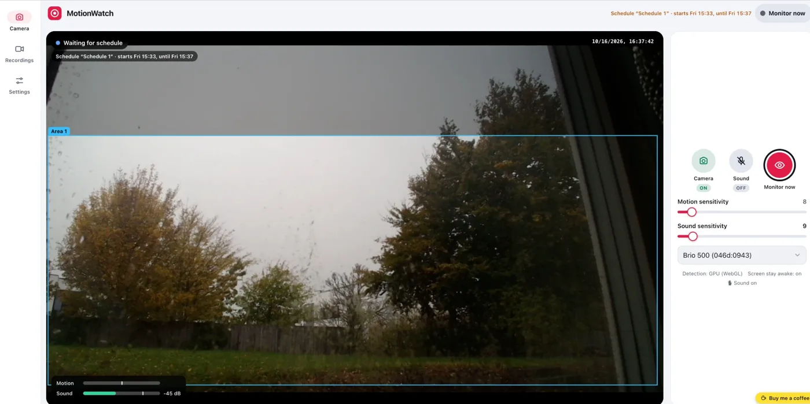
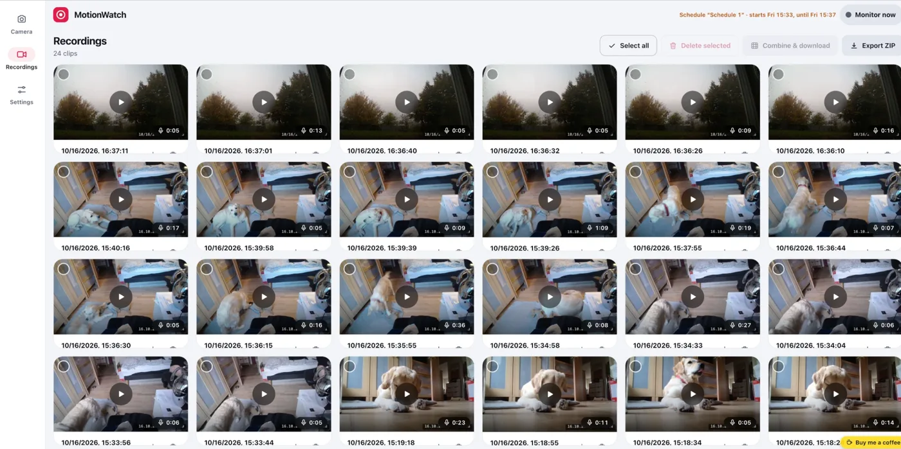
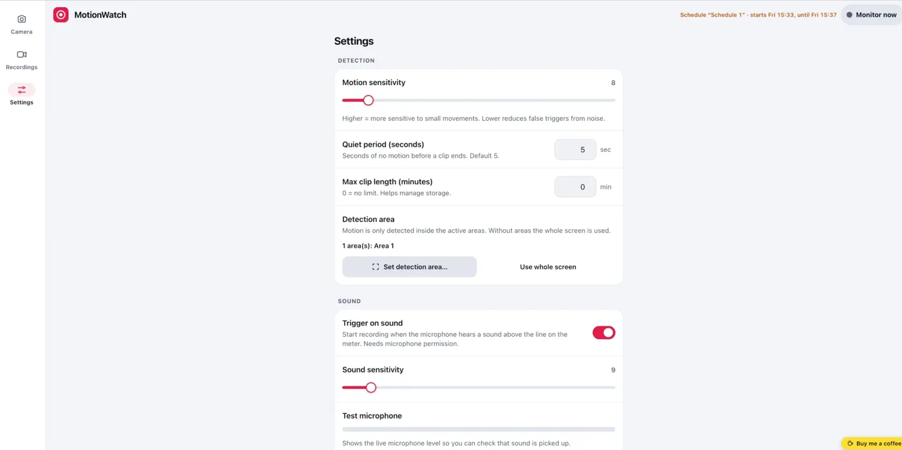

# MotionWatch

Privacy-first, browser-based **motion- and sound-activated video recorder**.
It uses your device camera (and optionally the microphone), watches for movement or noise, records short clips with a timestamp, and keeps everything **on your device** (IndexedDB). No cloud, no accounts, no analytics.

**Live:** https://netsi1964.github.io/MotionWatch/

<table>
  <tr>
    <td width="33%"><a href="docs/screenshots/camera.webp"></a><br><sub><b>Camera</b> – live view, detection area and level meters</sub></td>
    <td width="33%"><a href="docs/screenshots/recordings.webp"></a><br><sub><b>Recordings</b> – preview frames, select, combine and download</sub></td>
    <td width="33%"><a href="docs/screenshots/settings.webp"></a><br><sub><b>Settings</b> – sensitivity, areas, sound trigger and schedules</sub></td>
  </tr>
</table>

Works in current Safari (iPhone, iPad, Mac), Chrome/Edge and Firefox. Camera access needs HTTPS or `localhost`.

<a href="https://www.buymeacoffee.com/netsi1964" target="_blank" rel="noopener noreferrer"></a>

If MotionWatch is useful to you, you can [buy me a coffee](https://www.buymeacoffee.com/netsi1964). The app itself only shows a plain link (bottom right) and loads nothing from Buy Me a Coffee.

## Features

**Detection**
- Frame-differencing motion detection that runs on the **GPU** (WebGL fragment shaders in GLSL), with an automatic CPU fallback. The status line shows which one is active.
- Live **sensitivity** sliders for motion and sound, with a meter that marks the trigger point.
- **Detection areas:** draw any number of named areas on the live camera picture. Rectangles, ellipses and polygons; drag to move, drag handles (or use the keyboard) to reshape, convert between shapes, switch areas on/off. Each area has its **own sensitivity** (or follows the global one) and is judged separately, so motion in one area can trigger while a deaf one is ignored; the area that triggers is highlighted on the live picture. No areas = whole frame.
- **Sound trigger:** start recording when the microphone level crosses a threshold (Web Audio, level analysis only, nothing is played back). A live level meter (with dB value) shows whenever the microphone is open, and **Settings → Test microphone** shows the level without starting the camera, so you can see at once whether sound is picked up. If the browser holds audio back (Safari/Chrome autoplay policy) or the microphone is muted, the app says so on screen; any tap unlocks it.
- **Schedules:** named time windows (days of the week + from/to, past-midnight windows allowed) during which the app monitors, and records when triggered. No schedules = monitors whenever the camera is on. The header and the start screen always name the schedule that is running or the next one to start and when (*Schedule “Night” · starts 22:00, until 06:00* / *from 22:00 until 06:00*). A schedule that starts also resumes a paused app.

**Recording**
- Clips start when motion or sound is detected while monitoring and stop after a configurable quiet period; a **countdown** shows how long until the clip ends. Optional max clip length.
- **Monitor now / Pause** (the big button and the header pill) turns monitoring on or off right away. Monitoring means watching for motion or sound and recording a clip when something happens, never recording blindly. *Monitor now* overrides the schedule until you pause. A schedule that starts resumes a paused app by itself; pausing inside the window sticks until the next one starts. The camera power button turns the camera itself on or off.
- Optional **sound** in the clips (the **Sound** button on the camera tab, or Settings). The **Camera** and **Sound** buttons show their state (icon, colour and an On/Off label). A timestamp is burned into the video.
- Each clip gets a **preview frame** (the most active moment) for the recordings grid.

**Recordings**
- Responsive grid with preview frames and durations, delete, multi-select and bulk **ZIP** export.
- Built-in player with **previous / next clip** (buttons, or ← / → on the keyboard; Shift+←/→ seeks 5 s) and download of the clip being shown.
- **Combine & download:** select two or more clips and get them as one video (oldest first, with sound if the clips have it) with a **0.3 s black gap** between the clips (adjustable 0–5 s; no gaps in the timelapse). The browser cannot splice recordings directly, so the clips are played back into a new recording; it takes as long as the clips last and the tab must stay open.
- **Choose the output:** when combining, switch on the **combined video** and/or a **timelapse** (by speed-up ×2 … ×16 or by target length). One result is downloaded as it is; both come together in a **ZIP**.
- **MP4:** clips are saved as `.mp4` wherever the browser can record it (Safari, Chrome, recent Chromium) and as `.webm` otherwise (e.g. Firefox). Settings → Camera shows which one this browser uses.

**App**
- Modern responsive UI: bottom navigation on phones, navigation rail on wide screens, automatic **light/dark** theme (or force one in Settings), touch-friendly controls, toasts instead of alerts.
- Locales: English, Danish, Spanish, Simplified Chinese (switch at runtime).
- Accessibility: tab/radio/switch semantics, keyboard-operable area editor, focus management in dialogs, live regions, reduced-motion support, AA contrast.
- Screen Wake Lock while monitoring (when available). Installable as a PWA. The service worker is network-first: online, every load revalidates with the server so a deploy shows up on the next load; the cache is the offline fallback. When a new version has been cached, a banner offers a **Reload**; the app never reloads by itself, since a clip may be recording. (Open tabs keep running the files they loaded until you reload.)

## Settings in the URL

Settings are mirrored into the address bar, so a setup can be bookmarked or shared (Settings → *Copy settings link*). Query parameters override stored settings on load. Only non-default values are written.

| Parameter | Meaning | Values |
|---|---|---|
| `s` | motion sensitivity | 0–100 |
| `q` | quiet period before a clip ends (s) | 1–60 |
| `clip` | max clip length (min, 0 = unlimited) | 0–60 |
| `quality` | video quality | `low` `medium` `high` |
| `lang` | language | `en` `da` `es` `zh-Hans` |
| `theme` | colour theme | `auto` `light` `dark` |
| `preview` | how the live picture is painted (`canvas` helps when `<video>` stays black in some Safari versions) | `auto` `video` `canvas` |
| `awake` | keep screen awake | `1` / `0` |
| `audio` | record sound in clips | `1` / `0` |
| `sound` | trigger on sound | `1` / `0` |
| `ss` | sound sensitivity | 0–100 |
| `area` (repeatable) | detection area | `Name~r~x~y~w~h`, `Name~e~x~y~w~h`, `Name~p~x,y,x,y,…` (percent; append `~0` to disable and `~sNN` for the area's own sensitivity, e.g. `Door~e~20~20~40~50~s70`) |
| `sched` (repeatable) | schedule | `Name~days~HHMM~HHMM~1` (days `0`=Sun … `6`=Sat, last field `1`/`0` = on/off) |

Example:

```
?s=60&q=8&sound=1&ss=55&area=Door~e~20~20~40~50&sched=Night~0123456~2200~0600~1
```

Invalid values are ignored.

## Tests

```bash
npm ci
npm test                         # unit tests (node --test, no browser)
npx playwright install chromium
npm run test:e2e                 # end-to-end with a fake camera and microphone
```

The e2e suite drives the real app in Chromium (WebGL, MediaRecorder, IndexedDB, Web Audio): detection on GPU and CPU, areas and per-area sensitivity, schedules, pause/monitor-now, stop countdown, sound in clips (decoded and checked for non-silence), combined downloads, URL settings and responsive layouts. See `ACCEPTANCE.md`. A GitHub Actions workflow runs both on every push.

## Privacy

Videos stay in this browser on this device until you export them. There is no server-side recording path. The microphone is only opened when *Record sound* or *Trigger on sound* is on.

## Limitations

- Recording while the device is locked or the browser is suspended is **not** supported (especially on iOS); switching apps can interrupt the camera. Keep the page open and the screen on.
- Codec support varies: the app picks a supported MIME type at runtime and saves `.webm` or `.mp4` accordingly.
- Scheduled monitoring only works while the page is open.

## Run locally

```bash
python3 -m http.server 8080      # or: npx serve .
```

Open `http://localhost:8080`. There is no build step; the app is plain ES modules and Web Components.

## Deploy (GitHub Pages)

Settings → Pages → *Deploy from a branch* → `main` / `(root)`. Before each deploy run:

```bash
sh scripts/bump-version.sh
```

It stamps `src/version.js` (shown in Settings as `versionYYYY-MM-DD-HH-MM`, Danish time) and renames the service-worker cache so installed copies pick up the new files.

## Project layout

```
index.html, manifest.webmanifest, sw.js
src/main.js                 entry point
src/components/             web components: motion-app, camera-monitor, recording-list,
                            motion-settings, area-editor, app-tabs, status-indicator, icons
src/services/               motion (WebGL/CPU), sound, areas, schedule, recorder, storage,
                            settings, urlsettings, i18n, capabilities, zip
src/styles/                 tokens.css (theme), app.css, shared.js (design primitives)
src/i18n/locales.js         translations
scripts/bump-version.sh     version stamp
```
